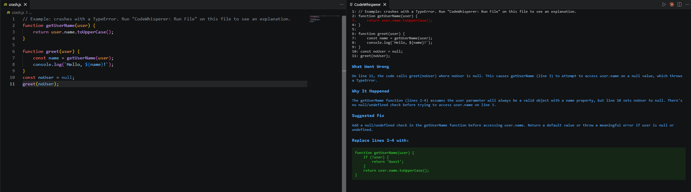

# CodeWhisperer

**CodeWhisperer** is a VS Code extension that runs your JavaScript file and, if it crashes, explains the error in plain English: what went wrong, why it happened, and a targeted fix with the exact lines to replace. The goal is to help students and junior developers understand a bug, not just patch over it.

Built solo during a weekend hackathon at Developers Institute (2nd place, fullstack track), then refactored after a code review.



## How It Works

1. **Run:** CodeWhisperer runs the open file with Node and captures its error output.
2. **Detect:** A non-zero exit code means the file crashed. A clean run just shows a confirmation.
3. **Explain:** The error and the full source file (with line numbers) are sent to Claude, which returns a structured explanation citing specific lines.
4. **Display:** A panel opens beside your code with the crash line highlighted in red, the explanation in blue, and the suggested fix in green.

## Prerequisites

- [Node.js](https://nodejs.org) (includes npm)
- [Visual Studio Code](https://code.visualstudio.com)
- An **Anthropic API key** with credit, from [console.anthropic.com](https://console.anthropic.com). This is separate from a Claude.ai subscription. You bring your own key and usage is billed to your account; each explanation is one short API call, so typical use costs very little.

## Setup

1. **Clone the repository:**
   ```bash
   git clone https://github.com/ShawnKerzner/Code-Whisperer.git
   cd Code-Whisperer
   ```

2. **Install dependencies:**
   ```bash
   npm install
   ```

3. **Compile:**
   ```bash
   npm run compile
   ```

4. **Run it:** Open the project folder in VS Code and press `F5`. This opens an "Extension Development Host" window with CodeWhisperer loaded.

5. **Add your API key:** The first time CodeWhisperer needs to explain an error, it asks for your key and stores it in VS Code's encrypted secret storage. To change it later, run **`CodeWhisperer: Set API Key`** from the Command Palette.

## Usage

1. In the Extension Development Host window, open a JavaScript file. To try it right away, use the files in [`examples/`](examples):
   - `examples/crash.js` throws a `TypeError`
   - `examples/clean.js` runs without errors
2. Open the Command Palette (`Ctrl+Shift+P` / `Cmd+Shift+P`) and run **`CodeWhisperer: Run File`**.

## Configuration

These settings are available under **Settings → Extensions → CodeWhisperer**:

| Setting | Default | Description |
|---|---|---|
| `codewhisperer.model` | `claude-sonnet-4-5` | Claude model used to explain errors |
| `codewhisperer.maxTokens` | `1024` | Maximum length of Claude's response |

The API key is deliberately **not** a regular setting. Settings are stored in plain text in `settings.json`, which can be synced or committed by accident, so the key lives in VS Code's secret storage instead.

## Project Structure

```
src/
  extension.ts   Command registration and the main run → explain → display flow
  runner.ts      Runs the file with Node and collects the exit code and error output
  claude.ts      Calls the Claude API using the user's settings
  prompt.ts      The prompt template sent to Claude
  parsing.ts     Line numbering, crash-line detection, and response parsing
  panel.ts       Builds and shows the explanation panel
  test/          Unit tests
examples/        Sample files for trying the extension
```

## Running Tests

```bash
npm test
```

Unit tests cover the pure parsing functions and use Node's built-in test runner, so no extra test dependencies are needed.

## Known Limitations

- Only supports Node.js / JavaScript files so far
- Requires your own Anthropic API key and credit

## Reporting Bugs

Please open a [GitHub Issue](https://github.com/ShawnKerzner/Code-Whisperer/issues) with:
- The code that triggered the error (or a minimal example)
- The message CodeWhisperer showed
- What you expected to happen
